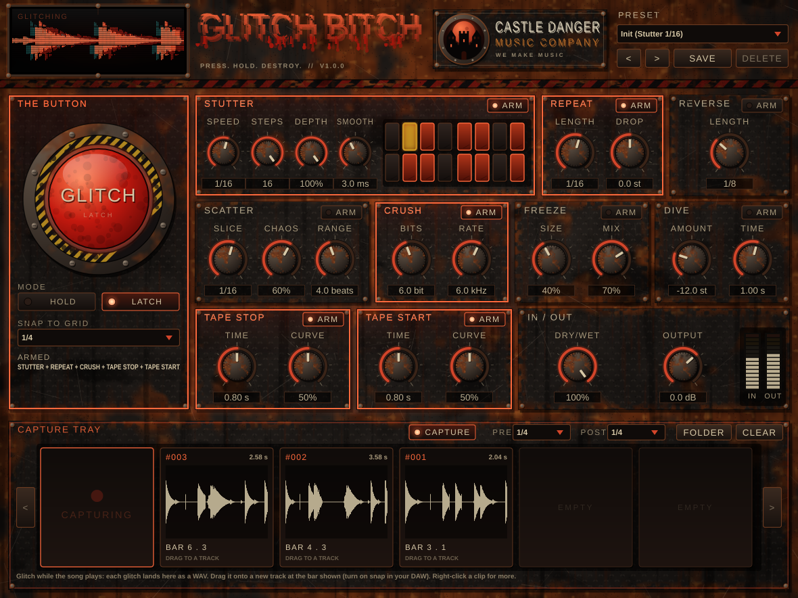

# Glitch Bitch: Press. Hold. Destroy.

A Castle Danger Music Company insert effect (VST3 / AU / Standalone, built with JUCE). Arm the effects you want, hit **THE BUTTON**, and everything armed fires at once. Every glitch is also captured as a WAV clip, with pre-roll and post-roll, in a tray you can drag straight onto a new track.



## The Button
- **Hold** mode fires while held. **Latch** mode clicks on and off.
- **Snap to grid** (Off, 1/16, 1/8, 1/4, 1/2, 1 Bar) holds presses and releases until the next grid line. A quick tap still fires for one grid step.
- It's an automatable parameter (`Glitch (The Button)`), so you can record presses as automation or map the button to a pad with your DAW. Every ARM switch is a parameter too.

## Effects (each with an ARM switch)
Chain order: Freeze → Repeat → Reverse → Scatter → Dive → Crush → Stutter → Dry/Wet → Tape Stop/Start → Output.

| Effect | What it does |
|---|---|
| **Stutter** | 16-step tempo-synced chopper (lit steps cut the volume). **Speed** dial steps through 1/2 to 1/64, with triplets. Steps, Depth and Smooth controls |
| **Repeat** | Grabs a slice when the glitch fires and loops it. **Length** 1/2 to 1/64, **Drop** bends each pass (sinking or rising) |
| **Reverse** | Each slice plays backwards right after it goes by |
| **Scatter** | Jumps back to random earlier slices, sometimes reversed or an octave off. **Slice**, **Chaos**, **Range** (1 to 8 beats) |
| **Crush** | Bit depth (16 to 2) and sample rate (24 kHz to 400 Hz) |
| **Freeze** | Granular drone of the moment under the sound. **Size**, **Mix** |
| **Dive** | Pitch slides down or up while held and glides home after. **Amount** ±24 st, **Time** |
| **Tape Stop** | Slows and grinds to silence. **Time**, **Curve** |
| **Tape Start** | Spins up from a dead stop. With Tape Stop also armed, it stops on press and spins back up on release |

Every engage, release and slice edge is crossfaded to avoid clicks. No latency.

**17 factory presets:** Init (Stutter 1/16), Chopper 1/32, Gate Keeper, Beat Repeat 1/8, Machine Gun, Sinking Repeat, Rising Panic, Tape Kill, Spin Cycle, Power Up, Backmask, Scatterbrain, Broken CD, 8-Bit Meltdown, Frozen Scream, Death Dive, Total Destruction. User presets are `.glitchbitch` files in `Application Support/Castle Danger/Glitch Bitch/Presets/` (macOS) or `%APPDATA%\Castle Danger\Glitch Bitch\Presets\` (Windows).

## Capture tray
- Each glitch is written as a 24-bit stereo WAV to `~/Music/Glitch Bitch Captures/<date>/`, named after the track, number and bar, for example `Drums - Glitch 007 - Bar 33.1.wav`.
- **Pre** and **Post** (Off to 2 Bars) keep clean audio around the glitch for crossfades. Post-roll starts after tails like tape spin-up end.
- Tiles show the clip's start (`BAR 33 . 1`), its length and a waveform. **Drag a tile onto a track** in your DAW. Right-click to reveal, remove or delete a clip. **Folder** opens the capture folder.
- With Snap on, clips start exactly on a grid line. Drop one on a new track with your DAW's snap on, at the bar shown, and it lines up.
- Every clip carries a Broadcast WAV time reference, so DAWs that read BWF timestamps (for example REAPER's *Move to source preferred position*) can put it back where it was captured.
- Capture runs off the audio thread: the audio thread writes into a 32-second lock-free ring, and a background thread streams the clip to disk.

## Building
Pushing to `main` builds macOS (VST3, AU, Standalone; universal) and Windows (VST3, Standalone) with GitHub Actions. Release zips are pushed to the `downloads-macos` and `downloads-windows` branches.

```
cmake -B build -DCMAKE_BUILD_TYPE=Release
cmake --build build --config Release --target GlitchBitch_VST3
```

`test/render_glitch.cpp` is a JUCE-free test of the DSP and capture logic (clicks, timing, snap, ring contents). CI runs it before every build.

See `readme.txt` for installation and `controls.txt` for the full control reference.
